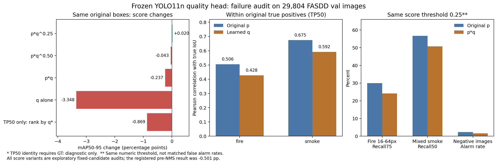

# FASDD n：质量头失败归因与下一阶段设计

更新：2026-10-10 19:20（北京时间）。本次新增只读推理、统计、论文与固定版本源码对照，没有启动新训练。cmj原T1继续运行。

## 1. 结论

当前质量头没有学到比原分类分数更好的精细定位排序。失败包含三个层面：监督的分数语义与推理乘法不一致；大量零IoU目标使普通BCE容易主要学习目标存在性；输入的DFL统计在真实正样本中没有论文示例那么强的质量信息。NMS前的候选过滤又放大了退步。

下一主模块改为**根据粗框边界取特征、直接预测四条边的坐标修正**。平行路线建立同数据教师，再做选择性的定位分布蒸馏。目标仍为n部署，前者参数预算不到1万，后者不增加部署结构。两条路线目前是登记设计，未实现、未训练，不能宣称已有增益。

先前GT排序oracle的+6.594点只证明“知道TP身份和真实IoU时可以改善排序”。它不能证明现有DFL特征能够预测这些信息，也不是当前模块可实现增益的估计。应修正此前对质量头潜力的乐观推断。

## 2. 已完成的证据

- Q0原始5轮训练与完整29,804张val三模式评估已完成。主方案NMS前评分：53.2633%→52.7624%，−0.5009点；NMS后评分：53.0264%，−0.2369点。
- 父检查点SHA、模型参数与BN状态检查通过；质量关闭精确复现原基线。新增只读审计前后，父权重和readout文件SHA均未改变。
- 新审计：全部4,323张train内部检查图，采样558,056个锚点、每锚点两类目标；完整val全部原NMS候选565,884个，逐框保存p、q、真实同类最大IoU、TP50–95和DFL统计。
- 原框固定的重新计算精确复现基线AP。p*q对原NMS后评分的差异仅0.000001个百分点，来自FP32数值顺序，远小于本次变化。
- cmj截至19:20完成84/100轮：T1 mAP50–95=52.906%，原seed0同84轮=52.756%，+0.150点。T1尚未完成，不能报告最终收益。

## 3. 核心原因与证据强度

### 3.1 当前q是带类别存在性的IoU目标，原p也已有质量监督

当前目标是`max same-class GT IoU`，背景和没有该类别的场景均设为0；每个锚点都监督fire/smoke两个输出。这是类别相关的联合目标，不能直接理解为“已知类别正确时的纯定位质量”。

源码中的TAL通过分类分数与框重叠度构建对齐度，并将归一化对齐度写入分类软目标，因此原p已有定位质量相关的监督。当前推理再用p*q，需要验证q提供的是新增定位信息，不能默认乘法成立。[固定版本TAL源码](https://github.com/ultralytics/ultralytics/blob/v8.4.42/ultralytics/utils/tal.py)

GFLV2虽也写成分类×质量，但训练时**直接对乘积J施加QFL**，分类与质量分支可以协同；我们的Q0冻结原分类头、只对q施加普通BCE。这是实质性的目标差别，并非论文的等价复现。[GFLV2第3.2节](https://arxiv.org/html/2011.12885v1#S3.SS2)

“重复学习类别/目标存在性并过度降分”是源码与统计支持的机制解释，尚未通过一次只改变监督语义的配对训练证明全部因果贡献。

### 3.2 全体样本的相关性掩盖了真阳性内部的排序弱点

train内部采样目标为0的比例：fire **76.410%**、smoke **73.550%**。普通逐图平均BCE仍主要覆盖零或低IoU目标。内部BCE由0.17650下降至0.16232不能直接说明高IoU排序改善。

对val原TP50单独检查：

| 统计 | fire | smoke |
|---|---:|---:|
| 原p与真实IoU的Pearson相关 | 0.506 | 0.675 |
| 新q与真实IoU的Pearson相关 | 0.428 | 0.592 |
| p与q的Pearson相关 | 0.885 | 0.920 |
| 控制p后的q–IoU线性偏相关 | −0.049 | −0.098 |

这表明本次q高度重复原p，而且真阳性内的质量排序弱于原p。线性偏相关不能排除所有非线性信息，但下面的AP排序实验提供了直接性能证据。

### 3.3 排序能力测试否定“只是阈值太严”这一解释

固定全部原NMS框、TP匹配和误报分数；只把每类TP50原有的置信度槽位按不同指标重新分配。AP50与每类分数分布完全保持：

| TP50内部排序指标 | mAP50–95 | 相对原模型 |
|---|---:|---:|
| 原分数 | 53.2633% | — |
| 当前预测q | 52.3946% | **−0.8687点** |
| 真实GT IoU | 59.8571% | +6.5938点 |

这两个重排实验都使用GT判定TP50身份，均为诊断，不能部署。重要信息是：即使替q消除了背景身份判断的困难，它在真实框内部仍排得更差。

固定原框的探索性评分比较：

| 分数 | mAP50–95 | 差值 |
|---|---:|---:|
| p*q^0.25 | 53.2833% | +0.0200点 |
| p*q^0.5 | 53.2201% | −0.0432点 |
| p*q | 53.0264% | −0.2369点 |
| q直接代替p | 49.9149% | −3.3484点 |

这些是同一val上的事后诊断，不能挑最优指数当新确认结果；也没有按新分数重做NMS。数据不支持仅调乘法强度就能得到有意义的大增益。将p*q开平方是单调变换，固定候选下不会改变排名，因此也不是排序修复。

### 3.4 DFL尖锐程度不能未经验证当成真实几何不确定性

在原TP50里，top4概率覆盖的平均质量：fire约**99.07%**、smoke约**98.07%**。top4概率均值接近其上限0.25，火焰上的额外区分信息弱：

| DFL特征与fire真实IoU | Pearson | 控制p后的偏相关 |
|---|---:|---:|
| 四边top1概率均值 | 0.219 | 0.036 |
| 四边top4概率均值 | 0.135 | 0.001 |
| 四边归一化熵 | −0.215 | −0.016 |

固定版本DFL监督把真实距离分解为相邻两个bin及其线性权重。例如真实距离3.0可以对应一个峰，3.5可以对应两个各0.5的峰；两者期望坐标都完全正确，峰值和熵却不同。这说明统计中还包含量化位置，不能把所有熵差异都解释成框误差。[DFL源码](https://raw.githubusercontent.com/ultralytics/ultralytics/v8.4.42/ultralytics/utils/loss.py)

另外，当前readout的mean是**期望bin坐标/15**；GFLV2的Topkm mean是**topk概率的平均值**，并强调其对分布位置移动的稳定性。我们的均值编码了距离/尺度，这是设计偏离，不能套用论文的尺度不变解释。[GFLV2统计定义](https://arxiv.org/html/2011.12885v1#S3.SS2)

这不否定DFL监督、定位蒸馏或所有质量估计方法；它否定的是未经校准就假设当前冻结DFL统计有足够的新排序信号。

### 3.5 NMS前进一步降分会删掉有效候选

在565,884个原NMS预测中，p*q使393,534个降到.001以下，其中包含原TP50 **1,926个**、TP75 **1,630个**。这些是原真阳性的阈值风险数量，后续NMS可能用其他框替代，不能当成最终净召回损失。

在原候选上固定数值阈值.25：

| 项目 | 原p | p*q |
|---|---:|---:|
| 16–64px火焰Recall75 | 29.990% | 24.131% |
| 混合场景烟雾Recall50 | 56.747% | 50.745% |
| 背景图告警率 | 2.320% | 1.575% |

告警变少伴随召回退步。这不是在同告警率下的能力比较，分数变化后阈值应重新校准；然而AP与TP内部重排的负结果不能由阈值校准修复。

此表按本次验证器实际resize后的框长边分箱，有7,936个16–64px火焰；之前按原图尺寸精确缩放640的清单有7,938个。边界舍入使2个实例分箱不同，本表前后使用同一集合，不能把两份表的微小差异当成模型变化。

### 3.6 当前5轮不是严格的收敛证明

heldout BCE仍下降、best在第5轮，不能完全排除更多训练对q有帮助。但原TP内部排序退步、输入信号弱、原目标与最终乘法不一致，都使“原样延长100轮”缺少依据。应先修正问题再做短实验。

训练square640、正式评估rect=true也可能造成输入分布变化；本次未隔离这一因素，不将其列为已确认主因。

## 4. 为什么此前模块也只有微小收益

- V2 context/detail_norm分支已在真实batch观察到非零且有一定幅度的特征贡献，不支持“模块没启用”的解释；它们主要改变局部/上下文特征，没有显式约束边界修正。
- 当前回归预训练迁移第84轮仅+0.150点，暂不支持“回归头重置是大幅退步主因”的判断；需等终局。
- 原fire在conf=.001时IoU.5/.75/.9一对一召回约96.44%/70.42%/21.21%。目标大多已有近似框，严格定位缺口仍大。质量排序只能选择已有框，无法创造准确边界。
- fire的<16px实例占772/20,984=3.68%，16–64px占37.83%。只提升最小检测层不会自动解决中等尺寸火焰的边界误差；实例占比不能当AP增益的数学上限。
- baseline seed0/seed1最终CSV为53.265%/53.530%，相差0.265点。V2的单seed微小差值不足以证明稳定收益，应做配对seed确认。
- 当前规范目录中的高分辨率证据是D-Fire：960约48.912%，640约47.706%。这不等于FASDD clean-v1上已验证960收益，不能混用数据集结论。

没有隔离证据把通道数、全部损失、标注或模型容量定为单一根因。标签政策审核仍pending，不能把模型边界误差全部归咎于标注。

## 5. 下一主模块：粗框引导的轻量边界修正

BorderDet与VarifocalNet提供了用预测框边界信息改善定位的研究依据；下面是适配n预算的自定义设计，不是声称已经复现其COCO收益。[BorderDet](https://arxiv.org/abs/2007.11056)，[VarifocalNet](https://arxiv.org/abs/2008.13367)

```text
原YOLO11n粗框 + 原64通道回归特征
  → 粗框中心、四边中点在原P3/P4/P5特征图上采样
  → 共享64→16投影，五点16维 + 原64维 + 3维尺度标识
  → 147→32，depthwise3×3，32→4
  → 四条边各±10%粗框宽/高的坐标修正
  → 原类别分数，原NMS
```

输出层零初始化，初始与原模型精确等价。按带bias且不使用BN的卷积估计新增**6,228参数**，共**2,596,458参数**，约+0.240%；实际实现须重新核算参数、显存与延迟。

每条边最多移动0.1倍粗框宽/高，即使两边反向修正，结果宽/高至少保留粗框的80%，避免倒置。第一项pilot冻结父模型及分类/BN，也detach粗框采样坐标；直接优化修正后的CIoU与归一化边偏移SmoothL1，监督只覆盖原TAL正样本且粗框IoU≥.3，按GT和图归一化。

保持训练集内部39,790/4,323划分，640、batch32、固定5轮。**按内部AP50–95选检查点，而不是BCE或回归loss**；选完再在官方val评一次。分类分数完全保持，能直接检验“框是否修准”。

增加归因对照：不修正；只学习四个常数边偏移；相同adapter和参数数但五个槽位重复原锚点中心特征。它们分别检验全局偏移校准、增加普通点特征容量和真实边界采样的贡献。内部AP使用与部署一致的rect640/conf=.001/NMS=.7/max_det300，派生图像清单放项目外runtime。正式输出按`results/fasdd_cv_clean_v1/fasdd-n-stage4/<method>/seedN/`保存。

预算门槛：官方val至少+0.5点，fire AP75同步增加，smoke AP50–95退步不超过0.2点；这只是继续投入预算的规则。达标后进入相同n640100轮配对实验：父模型仅接收原检测loss，边界模块通过独立优化器/裁剪组接收detached-input修正loss，以隔离改变父优化的混杂；梯度回流作为后续独立消融。

## 6. 平行路线：有可靠教师以后做定位蒸馏

目前检查到的规范结果目录没有合格的同FASDD clean-v1强教师。cmj完成T1后先验证YOLO11s在同数据、同640评估的教师实力；教师只用于训练，最终部署仍为n。

先要求teacher至少比匹配n基线高2点mAP50–95、3点fire AP75，再做定位蒸馏。若目标是+5点，最好能先找到更大的教师余量；+2点门槛仅用于启动筛选，并不保证学生能提升5点。

首项KD只蒸馏对应stride8/16/32锚点上的四边16-bin分布。teacher冻结，temperature=2、KL gain=.5；只在student TAL正样本中、teacher类别与GT一致、teacher该类概率≥.1、teacher IoU≥.6且比student高≥.05的位置监督。背景不占主要蒸馏损失，分类蒸馏另做消融。定位分布转移有论文依据，不能把论文COCO增益当成本任务预测。[Localization Distillation](https://arxiv.org/html/2102.12252v4)

先做从同一baseline best.pt出发的20轮fine-tune控制/KD配对，两边相同的优化器重置和训练配方。必须以fine-tune控制为归因基线，不能把延长训练本身的收益全部算给KD。有效后再做100轮与seeds0/1/2确认。

## 7. 两台机器下一轮分工与+5点目标

| 机器 | 下一项 | 所解决的问题 | 进入长训练条件 |
|---|---|---|---|
| lxy | 冻结n的5轮边界修正pilot | 是否能让现有框坐标更准 | +0.5点、fire AP75改善且smoke稳定 |
| cmj | 完成T1后，同数据强教师资格验证 | n是否缺少可迁移的定位知识 | 教师通过门槛后再做20轮配对KD |

标签审核并行使用既有300张train清单，核实火簇合并/拆分、发光区域、烟羽边界与漏标；没有人工政策和记录前不改标签。改动需建立新train版本，与模块实验单独归因，val标签固定。

5点目标的一个预算分解是fire AP50–95约+7点、smoke约+3点，平均为+5点，即整体53.263%→58.263%。这只是目标分解，不是收益预言。目前两个方向都需实验验证，没有证据承诺单个轻量模块能做到5点。

新设计登记：`configs/experiment-fasdd-n-stage4-design.yaml`；全部状态为未实施/条件设计。新审计脚本与产物：

- `analysis/scripts/audit_fasdd_quality_failure_20261010.py`
- `analysis/artifacts/fasdd_quality_failure_20261010_v2/summary.json`
- `analysis/artifacts/fasdd_quality_failure_20261010_v2/val_original_candidates.npz`
- `analysis/scripts/plot_fasdd_quality_failure_20261010.py`



说明：最初一次审计的AP重现断言过严，p*q误差仅0.000001个百分点，已在新目录重新运行并通过合理FP32容差；旧目录保留。后续没有修改已训练模型源码或历史结果。本次val评分变体为探索性诊断，后续确认不能事后继续挑选同一val最优参数。原val已经反复使用，新的实验属于同benchmark上的开发，独立泛化仍需明确的未使用数据评估。


## GitHub 同步证据

2026-10-10：用于复核本报告的紧凑统计和图已归档到 [证据目录](evidence/fasdd_quality_failure_20261010/)，包含 summary.json、registered_comparison.json 与诊断图。原始逐框 NPZ、日志、prepared 数据和缓存仍保留在原机器，不进入 Git。
