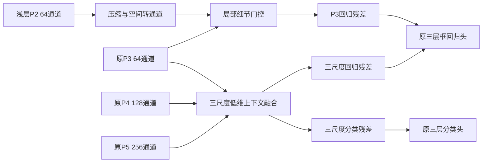

# FASDD：n规模模块设计 v1

日期：2026-10-08。当前任务范围限定YOLO11n。目标是固定FASDD clean v1、640与可比训练条件下提高mAP50–95；暂定+5点目标58.3975%。本方案是待实现、待训练的研究候选。

## 1. 设计依据和预算

检查报告：`analysis/reports/FASDD_N_MODULE_AUDIT_20261008.md`。现有基线2,590,230参数，P3/P4/P5通道64/128/256。当前错误同时涉及中小火焰定位、漏检、混合场景烟雾和框粒度；通道因果与特征错位尚未被直接证明。

保持n主干深度/宽度及三层预测位置，增加低维特征修正。工作预算约定：参数≤3.0M，实际同工具FLOPs增幅优先≤10%，同设备batch1延迟优先增幅≤10%。这些是本方案的工程筛选门槛，不是YOLO的官方n型号定义。超预算候选要单独报告，不因为参数仍少就称轻量。

## 2. 候选模块：细节与上下文残差

用F3/F4/F5表示原neck三层特征，D表示layer2的stride4特征。隐藏宽度r先取16，32留作容量消融。所有新增卷积默认无bias、无新增归一化；路由/gate使用bias，减维后用SiLU。



### A. 浅层细节进入P3回归

```text
d0 = SiLU(PW64→r(D))                         # 160×160
d1 = SiLU(PW4r→r(PixelUnshuffle2(d0)))       # 80×80
z3 = SiLU(PW64→r(F3))
g  = sigmoid(PW2r→r(concat(d1,z3)))
e  = g × SiLU(DWConv3(d1))
detail_regression = Wd(e)                    # r→64，Wd零初始化
```

目的：把已有浅层信息以小成本送给stride8框回归，检验中小火焰边界和遮挡细节是否有用。空间转通道保留压缩后特征的2×2位置排列，但前面的64→r投影已经压缩信息，不能称原特征无损。它不增加检测位置，也不能保证找回主干早期已丢失的视觉信息。

空间转通道与卷积是已有设计思路，参见[SPD-Conv原论文](https://arxiv.org/abs/2208.03641)。这里是受预算约束的局部旁路设计，未替换整个主干下采样，也不宣称该操作首次提出。

### B. 原三层上下文细化

```text
z_i = SiLU(PW_Ci→r(F_i)), i∈{3,4,5}
t_ij = resize(z_j, spatial_shape(F_i))
a_i = softmax(PW_3r→3(concat(t_i3,t_i4,t_i5)))
c_i = SiLU(DWConv5(sum_j a_ij × t_ij))
F_cls_i = F_i + W_cls_i(c_i)
F_reg_i = F_i + W_reg_i(c_i) + [i=3]×Wd(e)
```

上采样初版nearest，下采样按整数倍率average pooling；输入整除32时三层尺度关系明确。每层独立的分类/回归输出投影均为r→Ci，并零初始化。直接作用于P3/P4/P5，检验混合场景、烟框范围与火焰定位的收益。三尺度权重按位置计算；各尺度没有被监督定义为“火专家/烟专家”。

原n已有SPPF、C2PSA和neck融合。本模块检验的是检测前低维融合与任务分别修正的价值，不能假定原模型缺乏全局语义。nearest和average pooling也可能模糊或错位，初版没有连续可变形采样；需要用静态融合、单尺度和失败样本对照验证。

分类与定位特征关系已有研究，如[TOOD](https://arxiv.org/abs/2108.07755)；融合一致性和边界问题也有[FreqFusion](https://arxiv.org/abs/2408.12879)。本设计只是结合当前错误分布的候选，不是这些方法的完整复现，也不能仅凭结构组合宣称论文新颖性或FASDD收益。

### 起点、训练和诊断

保留原head参数并将新增输出投影置零，按公式设计为起点等价于原模型。新增层初始化隔离全局RNG；所有对照从同一预训练来源、同seed、共享层0..22策略开始。新增内部层在零输出投影打开后获得梯度，不能宣称从第一步都已学习。

残差输出没有强幅度限制。训练后应分别记录GT区域/背景区域的残差与父特征RMS比例、门控饱和、三个尺度权重和高IoU匹配变化。不能用整图平均gate或权重RMS替代机制证据。

## 3. 算术预算

640方形输入，卷积权重及MAC按上述明确设计计算：

| 隐藏宽度 | 预计新增参数 | 预计总参数 | 参数增幅 | 新增卷积MAC | 按2操作/MAC折算 |
|---|---:|---:|---:|---:|---:|
| r16 | 26,889 | **2,617,119** | +1.04% | 82.496M | 0.164992G |
| r32 | 56,841 | **2,647,071** | +2.19% | 184.653M | 0.369306G |

r16全模块中上下文约23,145参数，细节旁路新增3,744；两者共享z3减维。细节单独运行时需独立保留z3减维，参数约4,768，不能把共享节省算两次。

以上排除resize/pooling、激活、softmax/sigmoid、逐元素运算、位置重排和缓存/访存，不是完整FLOPs或实测延迟。实际代码、训练显存、导出和同硬件延迟都尚未验证。保留P2激活也会增加训练内存，参数增加少不能推出显存/速度几乎不变。

## 4. 对当前仓库的接入设计

拟新增`firesmoke/pyramid_refinement.py`，在`firesmoke/models.py`的模型构建后安装Detect子类适配器，首版限定当前Ultralytics8.4.42与end2end=false：

1. 先构建原n模型，使backbone/neck0..22与原head初始化保持一致。
2. 新head继承原Detect的cv2/cv3/dfl及stride、legacy、nc、reg_max等元数据；保持分类中间宽度64，三个预测层。
3. head层索引保持23，将输入索引显式设置为`[2,16,19,22]`，同时将2加入`model.save`。P2作为辅助输入，不能让标准Detect把它当成第四层。
4. 重写`forward_head`：生成三层F_reg/F_cls，分别送入原cv2/cv3，返回boxes/scores；`feats`只返回三层正确形状，继续匹配stride8/16/32和8,400位置。
5. 保留原输出/损失协议和默认TAL分配。额外分支状态键保存于head下，原cv2/cv3键可保留；未来更换迁移政策时仍需逐键核对。
6. 自定义类在正常Python模块中定义，加载时显式导入。保存/重载、BN融合、CPU/CUDA、混合精度及导出均需实现阶段验证，不能靠YAML注册或Python hook假定兼容。

此处是可执行实现的接口规格；**新模块代码、模型配置和训练启动器尚未创建**。本轮只保存检查/预算脚本与设计文档。

## 5. 首轮消融：模块贡献优先

所有实验固定FASDD clean v1内容指纹、原val标签/清单、n640、100轮、batch32、SGD、AMP=false、原增强与共享层0..22迁移。AP复核固定rect=true、batch64、conf.001、NMS IoU.7、maxdet300、augment=false、half=false。

| 编号 | 实验 | 回答的问题 |
|---|---|---|
| N0 | 原n基线，已完成seed0/1 | 原始B=53.3975% |
| N1 | 仅细节回归旁路，r16 | 浅层细节是否提高fire AP75与16–64px召回 |
| N2 | 仅三尺度上下文，r16 | 原三层上下文修正是否改善混合场景和烟雾 |
| N3 | N1+N2，r16 | 两部分是否有互补收益 |
| N4 | 常规局部瓶颈残差，同等预算 | 收益是否只是多一点卷积容量 |

先运行N1、N2的seed0：可分配lxy=N1、cmj=N2，结合父模型错误统计看收益方向；完成后再安排N3与容量对照N4。不要在初轮同时改变初始化、分辨率、轮数、损失和数据。

进入机制确认后按结果选择消融：

- N3固定均匀跨尺度权重：路由是否必要。
- N3分类/回归共享输出投影：任务分别修正是否必要；参数差异明确报告。
- N1用普通stride2下采样替代空间转通道：位置重排的贡献；尽量匹配参数/计算，并报告差异。
- r32：隐藏宽度容量对照，主干仍为n。

N4需在同样层级作用，参数/FLOPs尽量接近且报告实值，不能用远小于N3的局部卷积作唯一对照。先设计4个基准实验，再根据收益做少量有判别目的的内部消融，避免一次铺开所有模块组合。

## 6. 评价、继续条件与+5点目标

每次报告官方总体与分类别AP50/AP75/AP50–95；固定conf下的尺寸分层召回、纯烟/混合场景召回、背景图告警；训练时长、参数、同工具FLOPs和同硬件延迟。不同阈值下的P/R不能直接当作同工作点收益。

首轮筛选可用相对同seedN0增加≥0.5点作为工作阈值，并检查fire/smoke与背景告警的取舍；该阈值只用于预算管理，不代表统计显著性。仅seed0提高也不能称稳定。最终候选补seed1/2，原baseline补seed2，以三seed配对均值判断是否增加≥5点。

若N1/N2均无清晰收益，先复核其实际残差、梯度和失败类型，不直接叠加其它注意力。仅N2有效可保留N2；只有N1有效也不强行加入上下文。完成负结果仍要归档。

兼容预训练迁移、800训练、160轮和训练集标注审核可在模块贡献明确后分别加入；需要新的无模块配方对照。若总收益达到5点，要把模块收益和训练/数据配方收益分别报告，不把全部增加归给模块。

额外IoU质量预测先列为备用。当前TAL已给分类软目标引入重叠质量；进一步质量头需先发现置信度排序与框质量不一致，并采用训练/推理一致的监督与评分，不能只在推理阶段任意乘分数。[GFLV2的质量估计研究](https://openaccess.thecvf.com/content/CVPR2021/html/Li_Generalized_Focal_Loss_V2_Learning_Reliable_Localization_Quality_Estimation_for_CVPR_2021_paper.html)可作参考，其COCO结果不能当作本项目预期。

当前标注粒度和烟雾定义待审核，模块不能保证突破这些限制。数据、val、test和原训练结果保持固定，最终方案冻结后再评test。

## 7. 保存约定

实施阶段每个方法有独立配置、启动脚本与结果tag：

- 配置：`configs/protocol-fasdd-n-refinement-v1.yaml`。
- 启动：`scripts/train_fasdd_n_refinement.py`，默认只生成计划，执行时保存实际命令、协议/源码/数据SHA和初始化报告。
- 结果：`results/fasdd_cv_clean_v1/fasdd-n-refinement-v1/<baseline或detail或context或full或local_control>/seedN/`。
- 诊断：`analysis/scripts/`与`analysis/reports/`；中间产物`analysis/artifacts/`；运行日志仓库外。

本计划不以增加主干规模实现目标。候选仍需真实训练检验；目前没有证据可以承诺在n上通过该模块增加5点。
